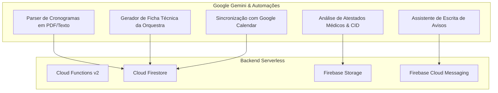

# Ecossistema Digital OER 🎵

> Plataforma completa e moderna desenvolvida para a **Orquestra Experimental de Repertório (OER)**. O ecossistema centraliza a rotina orquestral: divulgação de cronogramas e temporadas, avisos e notificações push em tempo real, controle de presença e chamadas de ensaio, agendamento de passagem de som, reserva de salas de estudo e automações inteligentes com Inteligência Artificial (Google Gemini).

---

## 🌐 Endereços Oficiais

| Módulo | Acesso | Descrição |
| :--- | :--- | :--- |
| 📱 **Portal do Músico (PWA)** | [oer-agenda.web.app](https://oer-agenda.web.app/) | Agenda de ensaios, temporada, avisos e notificações push. |
| 🔐 **Painel Administrativo** | [oer-agenda.web.app/admin.html](https://oer-agenda.web.app/admin.html) | Gestão geral, avisos, atestados, ficha técnica, calendário e configurações. |
| 📋 **Presença e Chamada** | [oer-agenda.web.app/presenca.html](https://oer-agenda.web.app/presenca.html) | Registro digital de chamadas, faltas, atrasos e justificativas em tempo real. |
| 🎻 **Passagem de Som (Músicos)** | [oer-agenda.web.app/passagem-som.html](https://oer-agenda.web.app/passagem-som.html) | Agendamento de horários de passagem de som para ensaios e concertos. |
| 🎛️ **Passagem de Som (Gestão)** | [oer-agenda.web.app/passagem-som-admin.html](https://oer-agenda.web.app/passagem-som-admin.html) | Painel do admin para configurar ciclos, horários e exportar para WhatsApp. |
| 🚪 **Reserva de Salas** | [oer-agenda.web.app/reserva.html](https://oer-agenda.web.app/reserva.html) | Agendamento simplificado de salas de estudo para os instrumentistas. |
| 🗓️ **Gestão de Agendamentos** | [oer-agenda.web.app/agendamento.html](https://oer-agenda.web.app/agendamento.html) | Painel administrativo de controle de salas e reservas ativas. |

---

## 🏛️ Módulos do Ecossistema

### 1. 📱 Portal dos Músicos (`index.html` - PWA)
*   **Visualização Instantânea da Agenda:** Acesso aos cronogramas de ensaios semanais e da Temporada oficial.
*   **PWA Instalável & Modo Offline:** Compatível com Android e iOS, permitindo instalação como aplicativo nativo e cache inteligente para carregamento sem conexão.
*   **Notificações Push (FCM):** Alertas imediatos para atualizações de cronograma, avisos urgentes ou alterações de ensaio, com suporte a badges, links profundos e imagens de capa.
*   **Letreiro Dinâmico (Ticker):** Banner contínuo no topo do app para alertas de prioridade máxima, controlável em tempo real pelo admin.
*   **Histórico de Avisos com Busca e OCR:** Consulta a comunicados passados com imagens anexas, suporte a leitura por OCR e pesquisa dinâmica por palavras-chave.
*   **Gestão Automática de Cache:** Limpeza inteligente de versões obsoletas de arquivos PDF e dados em cache no dispositivo móvel para economia de armazenamento.
*   **Design & Acessibilidade:** Alternador nativo de temas (Claro / Escuro / Sistema), Skeleton Screens para carregamento suave e canal de feedback integrado no rodapé.

---

### 2. 🔐 Painel Administrativo Geral (`admin.html`)
*   **Dashboard e Métricas de Engajamento:** Contagem precisa de dispositivos ativos recebendo notificações push, com rotinas de auto-cura para remoção de tokens inválidos.
*   **Gestão de Arquivos & Cronogramas:** Upload otimizado de novos PDFs com validação, compressão via `pdf-lib` e sincronização imediata.
*   **Disparo e Agendamento de Comunicados:** Envio imediato ou programado de notificações com suporte a texto rico, links externos e imagens de capa.
*   **Links Temporários & Atallhos Rápidos:** Criação de botões de destaque no portal do músico com extração automática de metadados ricos (Open Graph/Favicon).
*   **Banco de Músicos & RH:** Cadastro completo de integrantes da orquestra (bolsistas, monitores, convidados, cargos e instrumentos).
*   **Gestão de Dispensas e Licenças:** Controle detalhado de afastamentos programados, com registro de justificativas e impacto na frequência.
*   **Triagem e Laudo de Atestados Médicos:** Visualização, análise por IA e deferimento de justificativas médicas enviadas pelos músicos.
*   **Ficha Técnica Automatizada:** Compilação instantânea da formação orquestral em múltiplos formatos (Markdown, HTML/Email ou lista simples).
*   **Relatórios Executivos de Assiduidade:** Estatísticas consolidadas mensais de presença, faltas, atrasos e metas de ensaio por bolsista e naipe.
*   **Logs de Auditoria em Tempo Real:** Registro cronológico de todas as ações administrativas na coleção `adminLogs`.

---

### 3. 📋 Sistema de Presença e Chamada (`presenca.html`)
*   **Chamada Digital em Tempo Real:** Interface ágil para controle de presença em ensaios de naipe, ensaios tutti e concertos.
*   **Status Detalhado por Integrante:** Marcação rápida de Presença, Falta, Atraso com minutagem ou Dispensa justificada.
*   **Ajuste Dinâmico de Horários:** Modificação do horário de início/término do ensaio diretamente durante a chamada.
*   **Sincronização Segura:** Armazenamento resiliente no Firestore com suporte a reconexão automática e histórico de versões.

---

### 4. 🎻 Passagem de Som (`passagem-som.html` & `passagem-som-admin.html`)
*   **Fluxo em Etapas (Stepper UI):** O músico se identifica e seleciona seus horários (1ª e 2ª passagens) em um assistente guiado visualmente.
*   **Prevenção de Duplicidades:** Validação inteligente que impede marcações sobrepostas ou agendamentos repetidos pelo mesmo integrante.
*   **Painel Administrativo do Ciclo:** Gestão completa de datas, horários disponíveis, status ativo/inativo e edição manual de agendamentos.
*   **Cronograma para WhatsApp:** Gerador de texto pré-formatado com a lista diária de passagens de som para compartilhamento direto nos grupos do WhatsApp.
*   **Visualização para Impressão:** Layout dedicado para impressão rápida e afixação nos camarins e portas de palco.

---

### 5. 🚪 Reserva e Agendamento de Salas (`reserva.html` & `agendamento.html`)
*   **Reserva de Salas de Estudo:** Instrumentistas podem reservar salas disponíveis para estudo individual ou ensaios de câmara em etapas simples.
*   **Gestão de Capacidade:** Controle de lotação e restrições por sala.
*   **Painel de Supervisão:** Visão executiva de horários ocupados, cancelamentos e liberação de horários.

---

## 🤖 O Robô OER (Inteligência Artificial & Automações)

O **Robô OER** é o núcleo de automação inteligente do sistema, utilizando a API do **Google Gemini** (modelo `gemini-2.5-flash`) via SDK oficial `@google/genai`:



### 1. Assistente de Redação de Avisos (`suggestNotificationText`)
Auxilia o administrador na composição de notificações push persuasivas, claras e engajadoras. O robô considera os últimos registros administrativos, eventos recentes da orquestra ou imagens anexadas, sugerindo textos profissionais com temática musical.

### 2. Leitor & Extrator de Cronogramas (`parseScheduleWithGemini`)
Converte e-mails ou PDFs de avisos semanais em registros estruturados de calendário no Firestore:
*   **Separação de Eventos:** Ensaios de naipes distintos no mesmo dia são criados como eventos individuais.
*   **Inferência de Locais:** Ensaios sem local explícito são direcionados para `"Sala de Ensaios do TMSP (Subsolo)"`; concertos sem local tornam-se `"Teatro Municipal de São Paulo (TMSP)"`.
*   **Normalização de Horários:** Concertos dominicais no TMSP são padronizados para `"11:00"`; audições iniciam por padrão às `"13:00"`.
*   **Mapeamento de Links:** Extração limpa de coordenadas e links do Google Maps.

### 3. Extração e Parecer de Atestados Médicos (`onAtestadoUpload`)
*   **Leitura Automatizada:** Ao enviar um atestado (foto ou PDF), o Gemini extrai nome do músico, CID, data de início e quantidade de dias, gerando um parecer leigo e profissional para o RH.
*   **Relatório Visual Corporativo (`pdf-lib`):** Cria e anexa uma página de relatório ao documento original, contendo o logo da OER, tabela de dados e parecer analítico.
*   **Armazenamento Seguro:** O arquivo final é salvo em `atestados_processed/` e cadastrado com status pendente no Firestore, excluindo o arquivo temporário original.

### 4. Sincronização Inteligente de Calendário (`syncScheduleOnPDFUpload` & `forceSyncCalendar`)
*   Atualiza automaticamente o calendário da temporada e dos ensaios no Firestore e integra eventos ao Google Calendar corporativo da orquestra sempre que um novo PDF é aprovado.

### 5. Auto-Cura de Assinantes Push (`dailySubscriberCheck` & `checkSubscribersNow`)
*   Rotina diária às 6h da manhã para validar tokens e calibrar os contadores de assinantes.
*   Varredura manual acionável pelo painel do admin via `dryRun` no FCM, removendo instantaneamente tokens expirados ou aplicativos desinstalados.

### 6. Extração de Metadados de Links (`extractLinkMetadata`)
*   Extrai título, descrição e favicon de URLs externas cadastradas nos links temporários, gerando previews visuais nos cards do site público.

---

## 🛠️ Tecnologia e Arquitetura

*   **Frontend:** HTML5 semântico, Vanilla CSS3 (Design System próprio com variáveis CSS, Glassmorphism, temas claro/escuro) e JavaScript Modular (ES6+).
*   **PWA & Service Worker:** Cache dinâmico e background push centralizados em [`sw.js`](file:///Users/borisromaoantunes/Library/Mobile%20Documents/com~apple~CloudDocs/Developer/AI/Projeto%20-%20OER/sw.js).
*   **Banco de Dados:** **Firebase Firestore** em tempo real com regras de segurança granulares ([`firebase/firestore.rules`](file:///Users/borisromaoantunes/Library/Mobile%20Documents/com~apple~CloudDocs/Developer/AI/Projeto%20-%20OER/firebase/firestore.rules)).
*   **Hospedagem:** **Firebase Hosting** com CDN global, headers de controle de cache otimizados ([`firebase.json`](file:///Users/borisromaoantunes/Library/Mobile%20Documents/com~apple~CloudDocs/Developer/AI/Projeto%20-%20OER/firebase.json)) e pipeline de pré-deploy.
*   **Versionamento Dinâmico:** Atualização automática do hash de commit e data de release em [`version.json`](file:///Users/borisromaoantunes/Library/Mobile%20Documents/com~apple~CloudDocs/Developer/AI/Projeto%20-%20OER/version.json) a cada publicação.
*   **Backend Serverless:** **Cloud Functions (Node.js 22)** com gatilhos V2 e V1.
*   **Automação e IA:** **Google Gemini API** (`gemini-2.5-flash`), **Google Calendar API** e **pdf-lib**.
*   **Notificações Push:** **Firebase Cloud Messaging (FCM)** via protocolo WebPush.
*   **Ícones:** **Lucide Icons** leves via CDN.

---

## 📁 Estrutura Técnica das Cloud Functions

Todas as funções de backend estão concentradas em [`functions/index.js`](file:///Users/borisromaoantunes/Library/Mobile%20Documents/com~apple~CloudDocs/Developer/AI/Projeto%20-%20OER/functions/index.js):

| Função | Gatilho (Trigger) | Descrição |
| :--- | :--- | :--- |
| `sendPushNotification` | Firestore (`adminNotifications/{id}`) | Envia notificações push multicast em lote para todos os inscritos. Limpa tokens rejeitados. |
| `incrementSubscriberCount` | Firestore (`fcmTokens/{id}` - Criado) | Incrementa atomicamente o contador estatístico de inscritos. |
| `decrementSubscriberCount` | Firestore (`fcmTokens/{id}` - Excluído) | Decrementa atomicamente o contador de inscritos com guarda para valor mínimo zero. |
| `dailySubscriberCheck` | Scheduler (Diário às 6h - `0 6 * * *`) | Varredura de auto-cura de tokens, ajuste de métricas e relatório diário de tendências. |
| `suggestNotificationText` | HTTPS Callable (`onCall`) | Sugere textos curtos e mensagens temáticas para avisos usando Gemini 2.5 Flash. |
| `generateFichaTecnica` | HTTPS Callable (`onCall`) | Compila e formata a formação orquestral com auxílio de IA e cache local. |
| `scheduledNotificationHandler` | Scheduler (A cada minuto - `* * * * *`) | Localiza notificações pendentes na coleção `scheduledNotifications` e executa o disparo pontual. |
| `scheduleNotification` | HTTPS Callable (`onCall`) | Agenda notificações push para datas e horários futuros. |
| `onPDFUpload` | Storage (`onFinalize` em `pdfs/`) | Compacta e otimiza PDFs de cronograma com `pdf-lib` para download rápido. |
| `onAtestadoUpload` | Storage (`onFinalize` em `atestados_temp/`) | Processa laudos médicos com IA, gera folha corporativa e cataloga no Firestore. |
| `parseScheduleWithGemini` | HTTPS Callable (`onCall`) | Converte texto/PDF bruto de cronograma em JSON de calendário estruturado com regras da OER. |
| `checkSubscribersNow` | HTTPS Callable (`onCall`) | Faz auditoria física de tokens sob demanda via `dryRun` do FCM disparado pelo admin. |
| `syncScheduleOnPDFUpload` | Firestore (`config/pdf-info` - Escrito) | Sincroniza automaticamente eventos da agenda e Google Calendar quando o PDF é alterado. |
| `reprocessSchedulePDF` | HTTPS Callable (`onCall`) | Permite ao administrador reprocessar com IA um PDF já armazenado. |
| `forceSyncCalendar` | HTTPS Callable (`onCall`) | Força a sincronização pontual do calendário com o Google Calendar. |
| `extractLinkMetadata` | HTTPS Callable (`onCall`) | Faz scraping de Open Graph e favicon de links externos para cartões visuais ricos. |
| `webhookCadastroBolsista` | HTTPS Request (`onRequest`) | Endpoint seguro com token para integração externa de cadastro de bolsistas. |

---

## 🚀 Guia de Desenvolvimento e Manutenção

### 💻 Executando Localmente (Firebase Emulators)

1. **Instalar dependências:**
   ```bash
   npm install
   cd functions && npm install && cd ..
   ```

2. **Iniciar suíte de emuladores (Firestore, Storage, Functions, Hosting, Auth):**
   ```bash
   firebase emulators:start
   ```

3. **Definir privilégios administrativos (Claims):**
   ```bash
   node scripts/set_admin_claim.js
   ```

---

### 📦 Publicando para Produção (Deploy)

* **Deploy Completo (Frontend + Cloud Functions + Regras):**
  ```bash
  firebase deploy
  ```

* **Deploy Apenas do Frontend (Hosting):**
  ```bash
  firebase deploy --only hosting
  ```

* **Deploy Apenas do Backend (Functions):**
  ```bash
  firebase deploy --only functions
  ```

* **Deploy de Regras de Segurança e Índices:**
  ```bash
  firebase deploy --only firestore:rules,storage
  ```

---

<p align="center">
  
  <br>
  <strong>Orquestra Experimental de Repertório</strong><br>
  <small>© 2026 Projeto OER. Desenvolvido por Boris Romão Antunes.</small>
</p>
